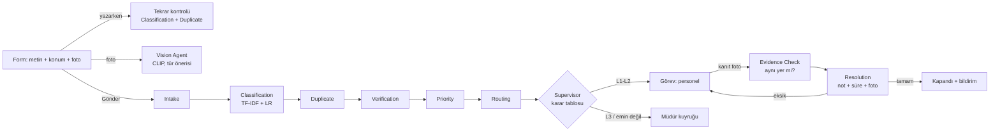

# Demo Senaryosu (sunum)

Sunumda gösterilecek akış: yaklaşık **8–10 dakika**, dört rol, iki bildirim. Amaç, jüriye sistemin özgün tarafını
göstermek: **yapay zekâ kararını kendisi verir, nedenini açıklar ve emin olamadığında insana bırakır.**

Yeni (23.11.2026): fotoğraftan tür önerisi, **bildirmeden önce tekrar kontrolü** ("Ben de yaşıyorum, destekle") ve
**kanıt fotoğrafı kontrolü** (Evidence Check Agent). Bunlar aşağıda 1, 3 ve 8. adımlarda.



Bu akış 16 Ekim 2026'da yerelde gerçek backend ve agent'larla baştan sona yürütüldü; her adım beklendiği gibi çalıştı.
Aynı adımlar otomatik testlerde de var (`frontend/e2e-real/`, [TESTING.md](TESTING.md)).

## Hazırlık (sunumdan önce, bir kez)

1. Temiz veritabanı ve dolu panolar için veritabanını sıfırlayıp demo geçmişiyle yükle (yerel veritabanını siler,
   GitHub'a ve arkadaşlarının bilgisayarına dokunmaz):

   ```bash
   docker compose down -v
   docker compose up -d
   docker compose exec backend alembic upgrade head
   docker compose exec backend python -m seeds.run --demo --history
   ```

   `--history` son 60 günün örnek bildirimlerini yükler (~1,5 dk); Genel Bakış, Raporlar ve Yapay Zekâ Performansı
   boş görünmez. Ayrıntı: [backend/seeds/README.md](../backend/seeds/README.md).
2. Siteyi aç: `cd frontend && npm run dev` → `http://localhost:3000`.
3. İki pencere hazırla: **telefon görünümü** (tarayıcı geliştirici araçlarında cihaz modu ya da gerçek telefon) bildiren
   ve personel için; **masaüstü** müdür ve yönetici için. Her pencerede ayrı oturum açmak için ikinciyi gizli pencere yap.
4. Hesaplar `backend/seeds/README.md` tablosunda; parola `.env` dosyasındaki `SEED_DEMO_PASSWORD`. Parola slayta ve
   ekrana yazılmaz.

| Rol | Hesap | Pencere |
|---|---|---|
| Bildiren (öğrenci) | `ogrenci@kampus.example.com` | telefon |
| Personel | `temizlik@` ya da `guvenlik@` (görev hangisine düştüyse) | telefon |
| Birim müdürü | `mudur.destek@kampus.example.com` | masaüstü |
| Sistem yöneticisi | `admin@kampus.example.com` | masaüstü |

## Akış

### 1. Bildiren sorunu bildirir (telefon, ~1 dk)

- **Bildirim Yap** → önce **fotoğraf ekle** (sabunluk fotoğrafı) → altında "Fotoğrafta görünen: Sabun bitti (%…)"
  önerisi çıkar → dokun, açıklama kendiliğinden yazılır → konum **B Blok Zemin Kat WC** → **Gönder**.
- **Söylenecek (foto):** "Görüntü modeli (CLIP) fotoğraftan sorunu tanıdı; öğrenci yazmak zorunda bile kalmadı.
  Model yeniden eğitilmeden, Türkçe/İngilizce tariflerle çalışıyor (sıfır örnekli öğrenme)."
- "Bildiriminiz alındı" ekranından **Bildirimlerim** → bildirimi aç. Birkaç saniye içinde zaman çizelgesinde
  "İlgili birime yönlendirildi" görünür.
- **Söylenecek:** "Öğrenci yalnız ne olduğunu ve nerede olduğunu yazdı; türü, önceliği ve birimi kendisi seçmedi."

### 2. Müdür yapay zekânın kararını okur (masaüstü, ~2 dk) — **sunumun kalbi**

- **Tüm Bildirimler** → numarayla ara → bildirimi aç.
- **Yapay zekâ kararları** bölümünü yukarıdan aşağı göster: Sınıflandırma (tür + güven %), Tekrar kontrolü,
  Öncelik (gerekçe maddeleri ve ağırlıkları), Yönlendirme (neden bu personel), Karar.
- **Söylenecek:** "Her adım bir gerekçe ve kullanılan model ile kayıtlı. Ücretli bir dil modeli yok; kendi eğittiğimiz
  sınıflandırıcı ve kurallar."

### 3. Personel işi yapar (telefon, ~1,5 dk)

- Personel hesabıyla gir → **Görevlerim**'de görev en üstte, kalan süre rozetiyle.
- **Kabul et** → **Başlat** → **Tamamla**: not + kanıt fotoğrafı (aynı sabunluğun yeni fotoğrafı).
- Müdür detayında **Kanıt kontrolü: "Kanıt fotoğrafı aynı yerden"** ve **İş kontrolü** kararları görünür.
- (Etkileyici varyant) Kanıt olarak alakasız bir yerin fotoğrafını yükle → görev personele geri döner, mesaj:
  "Kanıt fotoğrafı bildirimdeki yere benzemiyor; işin yapıldığı yerden fotoğraf ekleyin."
- **Söylenecek:** "Yapay zekâ işin yapıldığını da denetliyor: personelin fotoğrafını öğrencinin fotoğrafıyla
  karşılaştırıp aynı yer mi diye bakıyor. Kanıt yetersizse görevi geri gönderiyor, ikinci seferde müdüre bırakıyor."

### 4. Bildiren puanlar ve yorum yazar (telefon, ~1 dk)

- Bildirenin bildiriminde "Sorun çözüldü mü?" kartı → 5 yıldız → **Değerlendirmeyi gönder**.
- **Yorumlar** → "Teşekkürler, hızlı çözüldü." → **Gönder**.
- İsteğe bağlı: personel ya da müdür **iç not** yazar; bildirenin ekranında görünmediğini göster.

### 5. Yapay zekâ emin olmayınca insana bırakır (~2 dk)

- Bildiren: "Salonda priz kıvılcım çıkarıyor, yanık kokusu var." → konum **Yemekhane Salonu**.
- Müdür: **İnceleme Kuyruğu** → kartta "Yöneticiye iletildi", **Neden burada?** satırı ve **Yapay zekâ gerekçesi**
  (güvenlikle ilgili ifadeler önceliği kritiğe çıkarır).
- Bildirimi aç → "Bu bildirim kararınızı bekliyor" kutusu → **Onayla ve ata**.
- **Söylenecek:** "Güvenlik riski olan işi sistem tek başına atamıyor; karar ve sorumluluk müdürde. İsterse türü,
  önceliği ya da birimi düzeltir; düzeltmeler modelin yeniden eğitimi için kaydedilir."

### 6. Müdürün özet ekranları (masaüstü, ~1 dk)

- **Genel Bakış:** göstergeler, açılan/kapanan grafiği, **Yapay zekâ yönetim özeti**.
- **Raporlar:** en yoğun bina, birim performansı, tekrarlayan sorunlar.
- **Yapay Zekâ Performansı:** otomasyon oranı, müdür incelemesi oranı, düzeltilme oranları.

### 7. Yönetici denetimi (masaüstü, ~1 dk)

- **Yönetim → Yapay Zekâ Politikaları:** bir türün karar yetkisini "Müdür karar verir" yap (insan denetimi ayarı).
- **İşlem Kayıtları:** az önceki değişiklik kim, ne zaman, neyi değiştirdi diye görünür.
- Değişikliği geri al (sunumdan sonra veriler karışmasın).

### 8. Aynı sorun ikinci kez bildirilir: **gönder'e basmadan** fark edilir (~1 dk)

> **Sıra:** bu adımı **1. adımdan hemen sonra**, personel işi kapatmadan (3. adımdan önce) yap; ilk bildirim
> kapanınca artık "açık" değildir ve kart çıkmaz.

- Başka bir bildiren (ör. `akademisyen@`): "Erkek tuvaletinde sabun kalmamış" yaz → konum **B Blok Zemin Kat WC**
  (1. adımdaki bildirim hâlâ açık).
- Gönder'e basmadan formda **"Bu sorun zaten bildirilmiş olabilir"** kartı çıkar: tür, yer, kaç kişi bildirdi, ne
  zaman. Başkasının yazdığı metin gösterilmez (gizlilik).
- **Ben de yaşıyorum, destekle** → "Desteğiniz eklendi". Müdür ekranında ilk bildirimin "aynı sorunu 2 kişi bildirdi"
  sayısı artar; ilk bildirim kapanınca destekleyen de bildirim alır.
- **Söylenecek:** "Tekrar kontrolü agent'ı form anında çalışıyor: gereksiz kayıt hiç açılmadan önleniyor, ekip ikinci
  kez yola çıkmıyor; aynı sorunu kaç kişinin yaşadığı önceliği de yükseltiyor."
- Gönder'e basılırsa da kaçmaz: agent hattı aynı kuralla bildirimi mevcut kayda bağlar.

## Sunumda gösterilecek ölçümler

| Ne | Sonuç | Nasıl ölçüldü |
|---|---|---|
| Metinden tür (Classification) | accuracy **0,82**, macro-F1 **0,82** (± 0,03), tahmin ~15 ms | 5 katlı, şablon bazlı çapraz doğrulama (`ai/`, AGENTS.md 6) |
| Fotoğraftan tür (Vision, CLIP) | bekletilmiş 12 kampüs fotoğrafı: katalogdaki türler **6/6**; kapı kilidi/dolap 0/5 → tarif eklendi | önce ölç, sonra iyileştir (AGENTS.md 4.11); yeni fotoğraflarla tekrar ölçülecek |
| Kanıt fotoğrafı yer kontrolü | aynı yer **0/8** yanlış uyarı, farklı yer **43/58** yakalandı (eşik 0,80) | 66 fotoğraf çifti, kosinüs benzerliği (AGENTS.md 4.13) |
| Gecikme riski (SLA) | ROC-AUC **0,85** | zaman sıralı: eski %70 eğitim, yeni %30 test (ANALYTICS.md) |
| Test güvencesi | backend ~1.120, frontend ~920 otomatik test, uçtan uca testler | her PR'da CI |

**Dürüstlük notu (hoca sorarsa):** fotoğraf ölçümleri küçük sette; iyileştirmeden sonraki sayılar aynı fotoğraflar
için iyimserdir. Bu yüzden önce iyileştirmeden ölçtük ve bunu ayrı yazdık.

## Hoca sorarsa

- **"Neden ChatGPT kullanmadınız?"** Ücretli API yok, veri kampüs dışına çıkmıyor, her karar açıklanabilir ve
  ölçülebilir. Kendi sınıflandırıcımızı eğittik; görüntüde açık kaynak CLIP'i sunucuda çalıştırıyoruz.
- **"Yapay zekâ yanlış karar verirse?"** Supervisor güven ve risk düşükse otomatik uygular; emin değilse ya da
  güvenlik riski varsa müdüre bırakır. Müdürün düzeltmesi kaydedilir ve yeniden eğitimde kullanılır.
- **"Agent nedir, burada ne yapıyor?"** Her biri tek bir karar veren, girdisi ve gerekçesi kayıtlı modüller:
  sınıflandırma, tekrar, doğrulama, öncelik, yönlendirme, karar, izleme (SLA), iş kontrolü, kanıt kontrolü, görüntü.
- **"Kullanıcı dostu mu?"** Öğrenci kategori seçmez; fotoğraf çekip dokunur; QR ile konum hazır gelir; internet
  yoksa bildirim cihazda bekler; aynı sorun varsa "destekle" yeter; zil ile her adımdan haberdar olur.

## Olası sürprizler ve yedek plan

- **Görev kime düştü?** Destek Hizmetleri'nde iki personel var; yapay zekâ en boşta olanı seçer ya da görevi birimin
  havuzuna açar. Personel hesabıyla girince görev yoksa diğer personel hesabını dene.
- **"Tekrar" sayıldı:** aynı binada açık aynı sorun varsa yeni bildirim ona birleştirilir. Konumlar bu yüzden seçildi:
  demo geçmişinde B Blok'ta açık sabun, Yemekhane'de açık elektrik bildirimi yok (16 Ekim provasında doğrulandı).
  Provadan kalan açık bildirim varsa sunum öncesi veritabanını yukarıdaki gibi sıfırla.
- **Canlı site (staging) yavaş ya da kapalı:** Render'ın ücretsiz sunucusu uyur; ilk istek 30–60 sn sürebilir.
  Sunumu yerelde yap; canlı siteyi yalnız "her an açılabilir" diye göster.
- **İnternet yok:** her şey yerelde çalışır (Docker + `npm run dev`); dış servise ihtiyaç yoktur.
